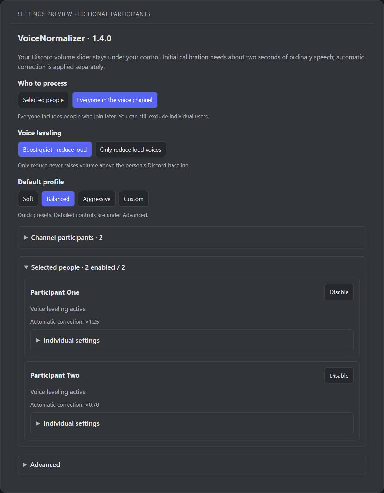

# VoiceNormalizer

**Русский** · [English](./README.en.md)

Плагин для BetterDiscord: приглушает громкую речь и усиливает тихую у отдельных участников или всех в голосовом канале. Пользовательская громкость Discord остаётся под вашим управлением.

[**Скачать плагин**](https://github.com/GameModify/voice-normalizer/releases/latest/download/VoiceNormalizer.plugin.js) · [Релизы](https://github.com/GameModify/voice-normalizer/releases) · [Настройки](./docs/SETTINGS.md) · [Сообщить о проблеме](https://github.com/GameModify/voice-normalizer/issues/new)

Стабильная версия — **1.4.0**. Автор: **GameModify** · [GameModify](https://github.com/GameModify)

*Демонстрация элементов настроек версии 1.4.0 с вымышленными участниками. Внешний вид зависит от темы Discord.*

## Установка

Нужен настольный Discord с BetterDiscord. Инструкция ниже — для Windows.

1. Установите [BetterDiscord](https://betterdiscord.app/).
2. [Скачайте VoiceNormalizer.plugin.js](https://github.com/GameModify/voice-normalizer/releases/latest/download/VoiceNormalizer.plugin.js) и положите в папку плагинов. На Windows: `%APPDATA%\BetterDiscord\plugins`.
3. Включите VoiceNormalizer в настройках BetterDiscord.

Для установки достаточно одного файла плагина. Node.js, архивы **Source code** и файлы проекта нужны только для разработки. В релизе также доступны MIT-лицензия и `SHA256SUMS.txt` для проверки загрузки.

Интернет нужен для скачивания и голосового соединения Discord. Плагин не обращается к отдельному серверу и не загружает код при запуске.

## Использование

Выставьте человеку комфортную громкость в Discord при его обычной речи. Нажмите на него ПКМ и включите **«Выравнивать громкость голоса»**. В подменю **VoiceNormalizer** можно выбрать его профиль или сбросить обучение.

Для первого обучения нужны примерно две секунды обычной речи. Более тихие фразы усиливаются, более громкие приглушаются. Если первоначальное обучение пришлось только на шёпот или крик, нажмите **«Сбросить обучение»**, когда человек говорит обычно.

Для всего канала откройте настройки плагина и выберите **«Всех в голосовом канале»**. Новые участники подключатся автоматически; отдельных людей можно исключить. Собственный голос не обрабатывается.

- Выбор участников, исключения и профили сохраняются после перезапуска Discord.
- Автокоррекция не двигает пользовательский ползунок громкости. Ручное изменение задаёт новую базу, сохраняя обучение.
- После громкого фрагмента громкость возвращается постепенно во время речи; в паузах сохраняется.
- При отключении обработки восстанавливается исходная громкость с учётом последних ручных изменений.

Ориентир обычной речи хранится до перезапуска плагина, после чего определяется заново. Значение громкости 0 сохраняет mute.

В режиме **«Только приглушать громкое»** усиление отключено: громкость не поднимается выше исходной базы человека.

## Профили

Для начала подойдёт **«Баланс»**.

| Профиль | Коэффициент коррекции | Реакция |
| --- | --- | --- |
| Мягкий | ×0,65–1,3 | Плавная |
| Баланс | ×0,45–2 | Средняя |
| Агрессивный | ×0,35–2 | Быстрая |

**Мягкий** подходит для небольших перепадов громкости. **Баланс** — для повседневных разговоров. **Агрессивный** быстрее реагирует и допускает более сильное приглушение. Максимальное усиление у него такое же, как у «Баланса»; отличаются сила коррекции и скорость реакции.

**Как у всех** использует общие настройки. Индивидуальный профиль заменяет их для одного человека. **Сбросить обучение** заново определяет средний уровень речи, сохраняя выбор участника и его профиль.

Списки участников раскрываются по нажатию. Профиль отдельного человека находится в разделе **«Индивидуальные настройки»** его карточки, точные параметры и язык — в разделе **«Дополнительно»**.

Коэффициенты в таблице применяются к внутренней громкости воспроизведения относительно ручной базы; это не положение ползунка и не измеренные децибелы.

## Обновление и данные

Скачайте новый `VoiceNormalizer.plugin.js` из [последнего релиза](https://github.com/GameModify/voice-normalizer/releases/latest) и замените старый файл в папке плагинов. BetterDiscord перезагрузит его. Выбранные участники, режимы и профили сохраняются.

Настройки хранятся локально в `VoiceNormalizer.config.json` рядом с плагином. На Windows: `%APPDATA%\BetterDiscord\plugins\VoiceNormalizer.config.json`. Перед обновлением можно скопировать этот файл в отдельную папку. Он содержит пользовательские ID и настройки; не прикладывайте его к публичному issue целиком.

При переходе с 1.3 прежняя общая цель громкости больше не используется: 1.4 обучается на обычной речи каждого человека. Выбор участников и остальные поддерживаемые настройки сохраняются. После обновления нужно короткое обучение.

Для отката отключите плагин, верните файл из [нужного релиза](https://github.com/GameModify/voice-normalizer/releases) и включите его. Если требуется восстановить резервную конфигурацию, заменяйте её при закрытом Discord.

## Ограничения и помощь

Плагин использует статистику Discord, а не обрабатывает аудиосэмплы: начало резкого пика может пройти до приглушения. Внутренние методы Discord могут меняться; при недоступном независимом управлении звуком обработка не включается. Совместимость с BetterVolume при повышенной громкости отдельно не подтверждена.

Если что-то работает неправильно, [создайте issue](https://github.com/GameModify/voice-normalizer/issues/new): укажите версию плагина, выбранный режим, шаги и ожидаемый результат.

[Подробные настройки](./docs/SETTINGS.md) · [Планы](./docs/ROADMAP.md) · [Разработка](./CONTRIBUTING.md)

## Лицензия

[MIT](./LICENSE) © 2026 GameModify.
